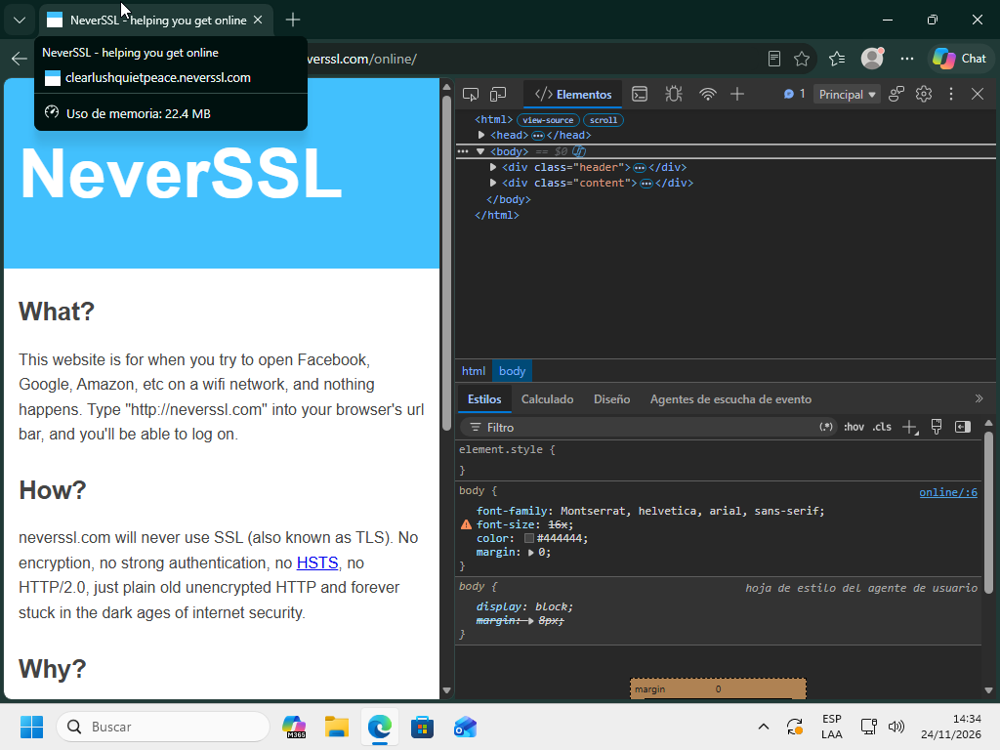
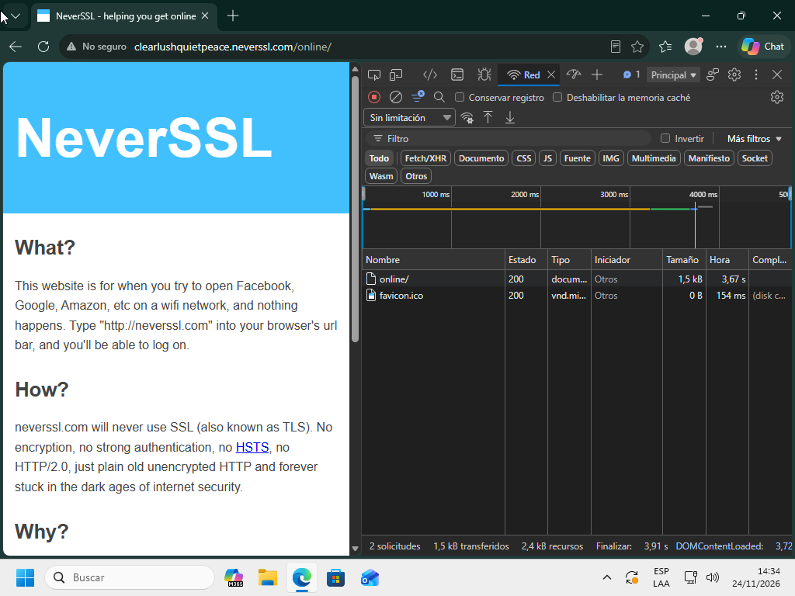
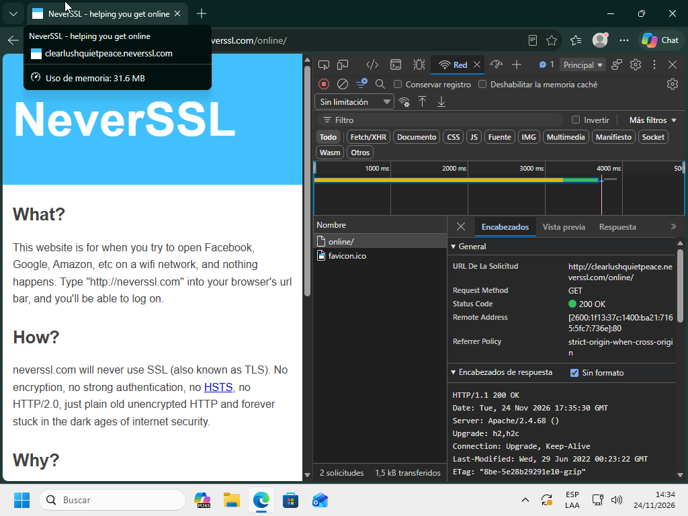

# practica-wifi-segura
## **Trabajo N°6 de Ciberseguridad**
Empezamos este trabajo entrando en la web "neverssl.com" y procedemos a ingresar al menu de desarollador (F12)

y rapidamente nos movemos a la seccion de network/red o en el caso de internet explorer el icono de "Wifi" 

para poder ver los datos que estamos buscando recargamos la pagina tocando el boton en pantalla  

luego de recargada la pagina aparecen los movimientos de red y 2 archivos, nos centramos en el primero llamado "online/" que es el que nos interesa y se despliega un menu con datos acerca de la web, en principio datos generales como la url y el metodo de solicitud entre otros

lo mas importante e interesante a destacar es que en este menu podemos ver los encabezados de respuesta de la web y los Request headers donde podemos observar datos a tener en cuenta como el protocolo de la web, su metodo GET e incluso datos del usuario.

### Analisis

Tenemos muchas cosas para prestarle atencion a los datos proporcionados por el menu desarrollador, en primera instancia tenemos que la web usa el protocolo HTTP que se puede leer en el [encabezado de respuesta](#ancla5).
También a destacar en [Request headers](#ancla6) podemos ver el host y el url de la web que en este caso es "clearlushquietplace.neverssl.com", el metodo GET de la pagina, el mismo protocolo HTTP, los headers de la pagina y el user-agent.

A la hora de navegar en una red publica hay que ser muy precavidos de usar una web que use el protocolo HTTP porque este tipo de webs dejan a la vista los que compartimos con ella, como formularios y credenciales siendo fácilmente interceptables por algun ciberdelinquente en la misma red en busca de posibles victimas.

Cosa que podria ser evitable en cierta medida usando una VPN, esto se debe a que las VPN nos enmascaran nuestra IP real dandonos una "falsa" mejorando nuestra privacidad y ofreciondonos un cifrado para nuestra navegacion en la web, muchas tambien ofrecen una seguridad extra que nos protege del trafico potencialmente peligroso, como malware o ransomware, eso no quiere decir que usar una VPN en una web que use HTTP sea que sea imposible de vulnerar, pero si mejora considerablemente nuestra seguridad para navergar en la misma y por el internet en general.

Por ultima unas 3 reglas para seguir siempre que se utilice una red puiblica para navegar: 1. Evitar paginas que usen HTTP, y de usarlas evitar ingresar credenciales o iniciar secion en las mismas. 2. Utilizar webs que usen HTTPS y tengan el icono del candado, esto no asegura que esa web sea segura, pero si que nadie en la red puede interceptar los datos puestos que estas usan cifrado. 3. Utilizar VPN para enmascarar nuestro IP, tapar muestros pasos y cifrar nuestros datos.
