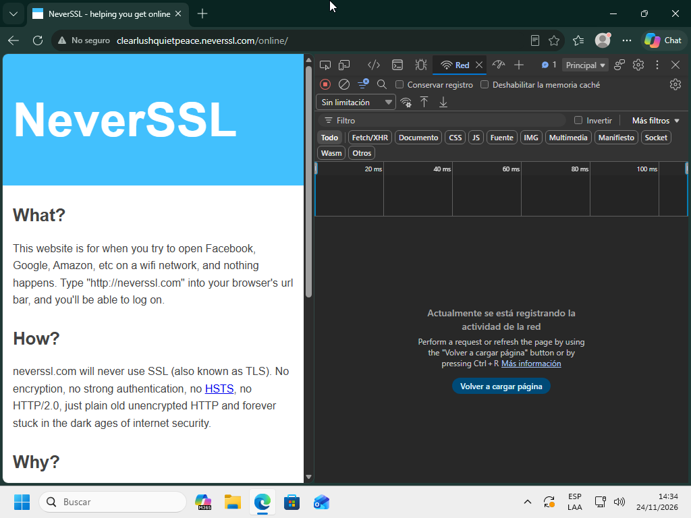
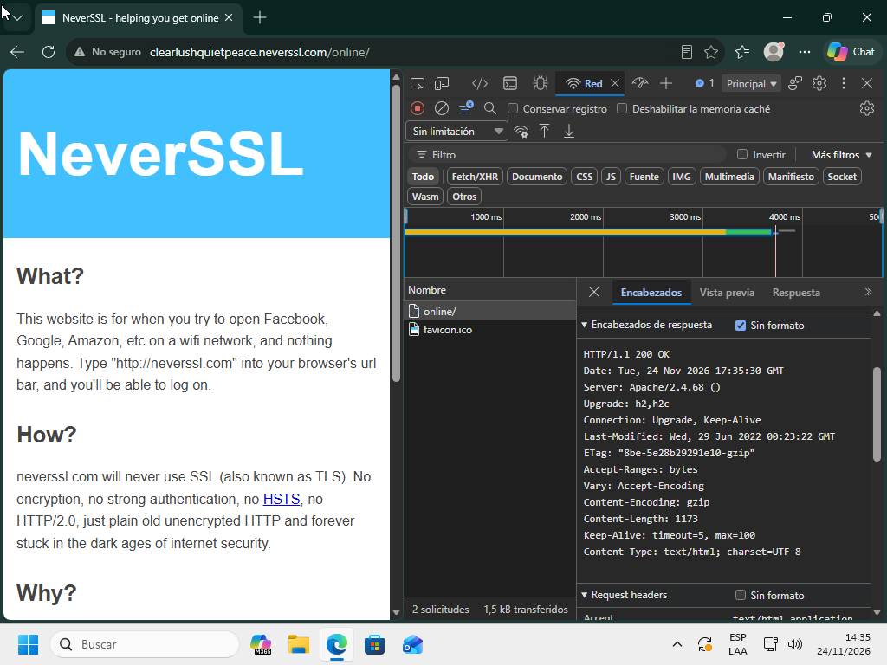

# practica-wifi-segura
## **Trabajo N°6 de Ciberseguridad**
Empezamos este trabajo entrando en la web "neverssl.com" y procedemos a ingresar al menu de desarollador (F12)

y rapidamente nos movemos a la seccion de network/red o en el caso de internet explorer el icono de "Wifi" 

para poder ver los datos que estamos buscando recargamos la pagina tocando el boton en pantalla  

luego de recargada la pagina aparecen los movimientos de red y 2 archivos, nos centramos en el primero llamado "online/" que es el que nos interesa y se despliega un menu con datos acerca de la web, en principio datos generales como la url y el metodo de solicitud entre otros

lo mas importante e interesante a destacar es que en este menu podemos ver los encabezados de respuesta de la web y los Request headers donde podemos observar datos a tener en cuenta como el protocolo de la web, su metodo GET e incluso datos del usuario.

### Analisis

Tenemos muchas cosas para prestarle atencion a los datos proporcionados por el menu desarrollador, en primera instancia tenemos que la web usa el protocolo HTTP que se puede leer en el [encabezado de respuesta](#ancla5)
